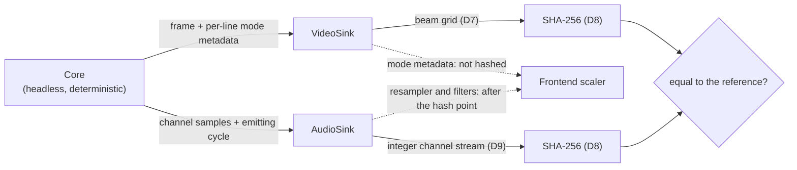

# ADR-TEST-05 — Compatibility is a measured number, not a claim

| | |
|---|---|
| **Status** | Accepted |
| **Date** | 2026-07-27; D7–D11 and the quarantine terms of D5 accepted 2026-10-23 |
| **Deciders** | Product Owner |
| **Scope** | Verification method, corpus governance, CI gating |
| **Depends on** | [ADR-CORE-01](ADR-CORE-01-cycle-accurate-timing-model.md) · [ADR-PORT-04](ADR-PORT-04-portability-and-backends.md) |

## Context

"99 % compatible" is the standard claim in this field and it is almost never falsifiable —
no corpus is named, no method is given, no run is reproducible. The project's headline goal
is a compatibility number, so the number has to mean something or the goal is decoration.

Emulator bugs are also disproportionately *regressions*: a timing fix for one demo breaks
three others, and without an automatic corpus nobody finds out for months. Manual testing
does not scale past a few dozen titles and cannot catch a one-frame desync at all.

Determinism (ADR-CORE-01 D6) and headless operation (ADR-PORT-04 D2) exist to make this
decision possible. This ADR spends them.

## Decision

**D1 · The corpus is a versioned manifest in the repository.** Each entry declares: title,
model and chipset configuration, the SHA-1 of the media it expects, an input script, and
the checkpoints at which output is hashed. The manifest is data under review like any
other file. **It contains no media** — only hashes of media the developer supplies.

**D2 · Verification is framebuffer and audio hashing at declared checkpoints.** A run is
driven by its input script in headless deterministic mode; at each checkpoint the full
overscan framebuffer and the accumulated audio are hashed and compared to stored
references. Games are additionally scored boot-to-playable; demos must match every
checkpoint, because a one-frame desync is a timing bug and the whole point is to catch it.

**D3 · A reference hash is only created from a verified-correct run.** Blessing output is
an explicit, reviewed act with a stated justification — never a bulk re-record. A
regression that gets blessed is a regression that becomes permanent.

**D4 · Three tiers, run at different cadences.**

| Tier | Content | Cadence |
|------|---------|---------|
| **Unit** | Original 68k test programs for CPU, chipset and timing behaviour; scheduler and decoder tests | Every commit, all platforms |
| **Redistributable corpus** | AROS boots, demos with explicit distribution permission, our own test programs | Every commit |
| **Full corpus** | Licensed games, Kickstart/Workbench revisions, ranked demoscene productions | Locally against media the developer owns; before every release |

CI can only run tiers 1 and 2 ([ADR-ROM-03](ADR-ROM-03-kickstart-rom-handling.md) D1). The
manifest marks which tier each entry is in, so the coverage gap is a visible number rather
than an unexamined assumption.

**D5 · The published compatibility figure carries its provenance.** Every claim states the corpus version, the build, the date, the pass count and the quarantine count. `26.1.0 — 1 847/1 863 (99.1 %), 12 quarantined, corpus 26.1` is a claim; "99 % compatible" is not.

The denominator is every entry the claim covers, quarantined entries included (D10). A quarantined entry is never in the numerator, so quarantine can lower the figure and can never raise it. In the example, the 12 quarantined entries are among the 1 863 and none of them is among the 1 847.

**D6 · Hardware tests are written before the subsystem, wherever the behaviour is known.**
They are the specification made executable, and they are what tells us the slot allocator
is right before six subsystems are built on top of it.

### What a checkpoint compares

D2 says what is hashed in outline. D7–D11 make it exact enough that two independent hashers, given the same run, produce the same digest, and say what happens to a title that real hardware itself does not run the same way twice.

**D7 · A video checkpoint hashes the raw beam grid, never a presentation of it.**

*What it means.* The hashed picture is every position the beam passes in one vertical pass, at the finest horizontal resolution any chipset has, holding the colour the display chip outputs there. Nothing is cropped, scaled, woven or filtered first. Display modes do not change the shape of the buffer: a lores pixel occupies four cells, a hires pixel two, a super-hires pixel one.

*Consequences.*

1. **Frame.** One vertical pass of the beam, from vertical position 0 until the vertical counter next returns to 0. An interlaced picture is two frames, one per field, and fields are never woven.
2. **Height.** The number of lines in that pass as the vertical counter produced them: 312 or 313 on PAL, 262 or 263 on NTSC, or the programmed total under ECS/AGA variable beam timing. Row 0 is vertical position 0.
3. **Width.** Eight cells per colour clock, times the length in colour clocks of the longest line in the frame: 1 816 cells for a PAL frame of 227-clock lines, 1 824 for an NTSC frame containing a 228-clock line. Cell 0 is the first eighth of colour clock 0 of the line. One cell is one super-hires pixel time (35 ns on PAL); a lores pixel (140 ns) is four cells and a hires pixel (70 ns) two.
4. **Cell value.** The colour the display chip outputs during that cell, after every bitplane, palette, EHB, HAM, dual-playfield, sprite and priority decision, as 8-bit red, green and blue. AGA's 24-bit colour is stored as is. OCS/ECS 4-bit components are widened by nibble replication (`0xA` becomes `0xAA`), so zero and full intensity are `0x00` and `0xFF` on every chipset.
5. **Blanking and unwritten cells.** A cell inside blanking holds what the chip outputs there, which is black. The buffer is set to `0x000000` at the start of every frame, so a cell the beam never writes, including the cells past the end of a line shorter than the frame's longest, is black and deterministic, never a leftover from an earlier frame.
6. **Serialisation.** A 16-byte header: the ASCII bytes `MAFB`, then the format version (1), the width and the height, each an unsigned 32-bit little-endian integer. Then the rows from row 0 downwards, each row left to right, each cell three bytes in the order R, G, B. No padding, no alignment, no compression.
7. **Mode metadata is not hashed.** The per-line mode metadata on `VideoSink` ([ADR-PORT-04](ADR-PORT-04-portability-and-backends.md) D2) is a hint for the scaler. The grid already holds the picture at full resolution, so the metadata adds nothing a hash needs, and hashing it would make every change to its format a bulk re-record, which D3 forbids.
8. **What `VideoSink` must allow.** Whatever frame format `VideoSink` is given when it is specified must let the hasher rebuild this grid exactly. If the frame is the grid, the hasher is a serialiser and not a second renderer. ADR-PORT-04 is not changed by this; it is a constraint on the port's format when that is written.
9. **What the reviewer sees.** The verification tool writes the hashed buffer as a lossless image on every blessing and every mismatch, so the review D3 requires looks at exactly the bytes that were hashed.
10. **Who pays.** A PAL frame is 1 816 × 313 × 3 bytes, about 1.7 MB per checkpoint, and only checkpoints are hashed. Frontends scale a grid four times wider than the lores picture, which specification §4 D-2 already makes their job.

*Why.* A row at each line's own resolution cannot represent a `BPLCON0` resolution change halfway along a line, which specification §3 T-2 requires to land at the right pixel; a fixed grid represents it without a rule. A canonicaliser hides exactly what the corpus exists to catch: cropping to the display window would hide a border split one cell late, in a field where programs move `DIWSTRT`/`DDFSTRT` outside the documented ranges routinely (specification §4). It is also a second renderer with its own defects, and its output is a picture nobody can hold against hardware when blessing it.

*Rejected.*

- Canonicalised presentation (cropped, scaled, interlace woven): hides overscan and border defects behind a second renderer, and every change to that renderer re-blesses the corpus.
- Rows at each line's own resolution: cannot represent a mid-line resolution change.
- Bitplane indices plus palette: undefined for HAM, sprites and playfield priority, which exist only as output colours.
- Hashing the mode metadata as well: its format is not pinned, and each change to it would force a bulk re-record.

**D8 · Checkpoint buffers are hashed with SHA-256.**

*What it means.* Both the video buffer (D7) and the audio stream (D9) are hashed with SHA-256 as specified in FIPS 180-4, using the full 256-bit digest. A reference is that digest written as 64 lowercase hexadecimal characters.

*Consequences.*

1. Comparing a checkpoint is string equality between two 64-character values in the manifest.
2. Anyone can check a reference with standard tools: dump the buffer, run `sha256sum` on it. Every mainstream language and platform has a vetted implementation, so a second hasher needs nothing from this project's code.
3. The algorithm is tied to the serialisation format versions in D7 and D9. Changing it means re-hashing every reference from its run, which is a bulk re-record, so it changes only by superseding this decision.
4. At about 1.7 MB per video checkpoint the hash is not the bottleneck of a headless run; current x86-64 and AArch64 processors have SHA-256 instructions.

*Why.* A reference is committed once and compared for years, so the hash has to stay collision-resistant for that long and be computable without trusting this project.

*Rejected.*

- SHA-1, already used for media identity in D1: practical collisions are public, and a reference meant to last years should not start weak. D1 is not reopened by this.
- BLAKE3 or xxHash: faster, but outside standard libraries (and xxHash is not collision-resistant); speed is not the constraint here.

**D9 · Audio is compared exactly.**

*What it means.* An audio checkpoint passes only when its digest equals the reference. There is no metric and no threshold. What is hashed is the integer output of Paula's four channels as the core emits it, before the host-rate resampler of specification §5 A-1 and before any output filter.

*Consequences.*

1. **Segment.** Each checkpoint hashes the audio since the previous checkpoint, or since power-on for the first, as specification §9's "audio hash per segment" says. A segment ends at the colour clock where the checkpoint's frame ends. Cycles are counted in colour clocks since power-on.
2. **Records.** Twelve bytes each, little-endian: cycle (unsigned 64-bit), channel (unsigned 8-bit: 0–3 for Paula's channels, 4 for the output filter), sample (signed 8-bit), volume (unsigned 8-bit, 0–64), one reserved byte set to zero. Sample and volume are what the channel presents to its DAC at that cycle; a channel the hardware silences presents volume 0. Channel 4 records the audio low-pass filter control that shares the power LED's CIA bit: sample 1 when on, 0 when off, volume 0.
3. **Order.** A segment opens with one record per channel 0–4 giving its state at the segment's first cycle. After that, a record is written whenever a channel's sample or volume changes. Records are ordered by cycle, then by channel.
4. **Serialisation.** A 24-byte header: the ASCII bytes `MAAU`, the format version (1) as unsigned 32-bit, the segment's first cycle and its end cycle (exclusive) as unsigned 64-bit, all little-endian. Then the records. Hashed per D8.
5. **What `AudioSink` must allow.** Its format, when specified, must carry this information losslessly. The resampler and the filters sit after the hash point, as presentation, so they may change, or use floating point, without touching a reference or ADR-CORE-01 D6.
6. **What a mismatch means.** A defect, always. No change to the resampler or the filters can cause one, so there is never a case for re-blessing audio because presentation improved.

*Why.* Paula's path up to the DAC is integer: 8-bit samples, volumes 0–64, periods counted in colour clocks. Under ADR-CORE-01 D6, two correct runs therefore produce identical streams, and a tolerance would have nothing legitimate to absorb. It would also be dangerous: a one-frame desync moves every later record by about 71 000 colour clocks on PAL (227 × 313), so any metric loose enough to forgive timing slack forgives the desync D2 says must fail, and a metric that forgives neither timing nor amplitude is exact comparison. The only positive reason for a tolerance is comparing against an analogue capture from real hardware, which is hardware validation, not this corpus.

*Rejected.*

- Tolerant comparison (signal-to-noise or maximum-difference threshold on the host-rate output): needs a reason D6 removes, and any threshold that absorbs timing slack absorbs a one-frame desync.
- Exact comparison of the host-rate output: puts the resampler and filters inside every reference, so improving them would re-bless the corpus.

**D10 · A title that is non-deterministic on hardware has its power-on state pinned; one whose correct output still cannot be established is quarantined, and counts as failing.**

*What it means.* Chip RAM contents at power-on, disk rotation phase and CIA state at reset vary between real machines, but in this emulator they are configuration, not chance. Each entry fixes them; once fixed, the title produces one output and is checked like any other. A title whose correct output under those fixed conditions cannot be established, so no reference can be blessed under D3, is quarantined: it still runs, it must still reproduce itself, and it counts as not passing.

*Consequences.*

1. **The entry pins the power-on state:** chip and slow RAM contents, each drive's rotation angle at power-on, and CIA timer and time-of-day state at reset. Defaults: all RAM `0x00`; every drive at its index position; each CIA register in the reset state the Hardware Reference Manual documents for it, and zero where it documents none. An entry departs from a default only with a stated reason.
2. **More than one state is more than one entry.** A title worth checking under several power-on states is listed once per state; each listing has its own references and counts in the figure on its own.
3. **Quarantine is a reviewed status.** It is a manifest field with a stated reason, entered and left by the same explicit, reviewed act as a blessing (D3).
4. **Quarantined entries still run** at their tier's cadence, twice; two runs that differ are a build-breaking defect, as for any entry.
5. **Quarantined entries stay in the denominator** and are never in the numerator, and the claim states how many there are (D5).
6. **A run that differs from itself** under the same configuration is an emulator defect under ADR-CORE-01 D6, never a reason to quarantine.
7. **No entry carries a tolerance,** a mask, or a set of alternative accepted digests.

*Why.* A quarantine that leaves the denominator rewards quarantining the hard cases, which is the unfalsifiable figure this ADR exists to prevent. Counting it as a failure costs the figure exactly what the title costs, so the incentive points at fixing it. Pinning the power-on state removes the non-determinism at its source instead of tolerating its effects.

*Rejected.*

- Per-entry tolerance or masked regions: a knob tuned per title until it passes, and a masked region hides a one-frame desync inside it (D2).
- Quarantine outside the denominator: lets the figure rise by setting the hard cases aside.
- Several accepted digests per checkpoint: weakens every checkpoint of the entry to "any of these", and is never needed once the power-on state is pinned.

**D11 · Reference digests and input scripts are published, for every tier.**

*What it means.* The manifest, with its reference digests and input scripts, lives in this public repository for all three tiers, including the full corpus CI cannot run. Anyone who owns the media can re-run an entry and compare.

*Consequences.*

1. Manifest files hold configurations, power-on state, input scripts and digests, and nothing else. They hold no media (D1), and no frame image or audio of a full-corpus title, since a dumped frame of a licensed game is a copy of its output.
2. The lossless images written at blessing (D7) for a full-corpus entry stay on the blesser's machine, and the review record carries the justification, not the image. Reviewing such a blessing needs a reviewer who owns the media.
3. A third party reproduces an entry with its own media, the published input script and the pinned configuration, and compares digests (D8).

*Why.* A figure only this project can reproduce is a claim, not a measurement. The full corpus is where the headline figure is decided, so it is the tier that most needs to be checkable from outside.

*Rejected.*

- Publishing tiers 1 and 2 only: the headline figure would rest on references nobody outside can check.
- Publishing the figure alone: D5's provenance would name a corpus nobody can inspect.

## Consequences

- Building the corpus and its reference hashes is substantial, ongoing work that produces
  no visible feature. It is planned as first-class work, not absorbed into slack.
- Reference hashes are only as good as the run that produced them. D3 is the control, and
  it depends on human discipline; it is called out in the review checklist for that reason.
- Demos must be run with explicit distribution permission to enter tier 2. Obtaining that
  permission is outreach work, and the tier-2 corpus will start small.
- Determinism becomes load-bearing. If a change makes a run non-reproducible, the corpus
  stops working — so non-determinism is a build-breaking defect, not a curiosity.
- Bisecting a compatibility regression becomes mechanical: the corpus identifies the
  commit, the input script reproduces it, the deterministic core makes it repeatable.
- The manifest format follows from D7–D11. Each entry carries its tier, its pinned power-on state with the reason for any departure from the defaults, its input script, an optional quarantine status with its reason, and for each checkpoint a frame index, a video digest and an audio segment digest, with the serialisation format versions those digests were computed under.

## Open decisions

None at present.

## Follow-up checks

- D9's rule that a channel the hardware silences presents volume 0 is a modelling choice. Verify it against the Hardware Reference Manual's description of Paula's channel and DMA behaviour when the audio implementation lands, and amend D9 if the hardware says otherwise.
